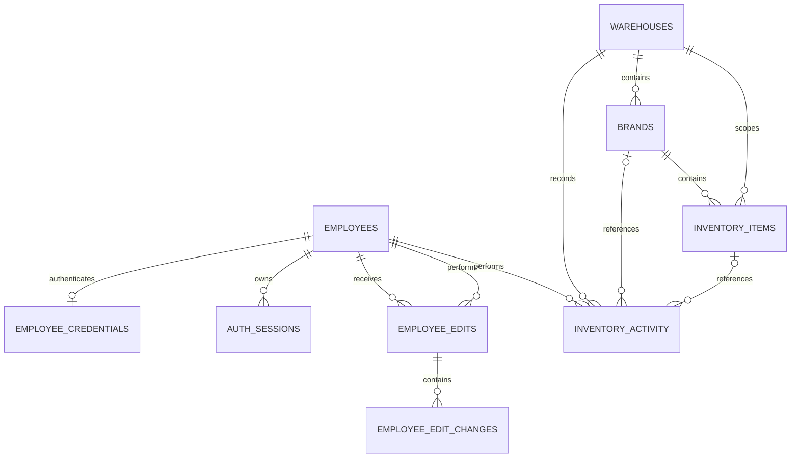

# G-Stock backend and database schema

Proposed design based on the current React frontend. This is a specification, not an implemented backend or a database migration.

## Current scope and evidence

The frontend supports email/password sign-in, an employee profile card, searchable employee accounts and audited edits, warehouse creation, warehouse-specific brands, stock item creation, stock quantity adjustments, activity history, and stock movement reports.

The current persistence is browser `localStorage`; authentication and mutations run in the browser. The main sources for this design are:

- `Gstock/src/types/employees.ts` and `Gstock/src/data/employeeAccounts.ts`
- `Gstock/src/types/inventory.ts` and `Gstock/src/data/inventoryStore.ts`
- `Gstock/src/types/reports.ts` and `Gstock/src/data/reports.ts`
- `Gstock/src/App.tsx` and the Inventory, Warehouses, EmployeeAccounts, and Reports components

Assumptions: one organisation, shared warehouse visibility for authenticated employees, and a relational database. PostgreSQL types are used below to make the proposal concrete. Authentication sessions and the internal employee-management permission are proposed backend additions. Everything else follows the existing screens and data rules.

## Backend structure

```text
React frontend
    |
    | HTTPS JSON API, /api/v1
    v
Authentication and permission checks
    |
    +-- Authentication: sign-in, sessions, sign-out, current employee
    +-- Employees: search, profile updates, password updates, edit history
    +-- Warehouses: search, details, creation
    +-- Brands: search, warehouse grouping, creation
    +-- Inventory: items, stock status, summaries, quantity adjustments
    +-- Activity: warehouse / brand / item history
    +-- Reports: aggregate recorded stock movements
    |
    v
Database transactions and PostgreSQL
```

These are modules within one backend application; separate services are not required by the frontend.

## Database relationships



A brand belongs to exactly one warehouse in the current frontend. Reusing a brand name in another warehouse creates a separate brand record. An item belongs to one brand and has one storage location and quantity. This model has no shared product catalogue or stock transfers.

### Shared database conventions

- Primary keys: `uuid`, generated by the backend/database. Frontend IDs remain strings in JSON.
- Foreign keys below use `ON DELETE RESTRICT` unless stated otherwise. There are no delete screens; preserve records referenced by audit history.
- Times: `timestamptz`; use server-generated instants and return ISO 8601 strings. Reports and display use `Africa/Johannesburg`.
- Required text must be nonblank after trimming. Trim text before validation and storage.
- Database columns use `snake_case`; API fields use the existing frontend's `camelCase`.
- `created_at` and `updated_at` are server-managed. Update `updated_at` on mutations; a default alone does not keep it current.

### 1. employees

One account/profile per staff member; a separate generic users table is not needed for the current staff-only app.

| Column | Type | Rules / purpose |
| --- | --- | --- |
| id | uuid | Primary key; frontend `profile.id` |
| employee_id | varchar(32) | Required; case-insensitive unique; frontend `employeeId` |
| full_name | varchar(100) | Required |
| email | varchar(254) | Required; valid email; case-insensitive unique |
| department | varchar(80) | Required free text, as in the form |
| role | varchar(80) | Required job title, as in the form |
| can_manage_employee_accounts | boolean | Proposed internal permission; default false; not editable through the profile form |
| created_at | timestamptz | Required; default current time |
| updated_at | timestamptz | Required; default current time |

Use unique indexes on `lower(email)` and `lower(employee_id)`. Keep the display role separate from the permission: an editable title must not grant access to change other employees' passwords. Provision authorised managers through an administrative process. A server policy allowing every employee to edit accounts would match the preview, but is not the default proposed here.

### 2. employee_credentials

| Column | Type | Rules / purpose |
| --- | --- | --- |
| employee_id | uuid | Primary key and FK → employees.id |
| password_hash | text | Required server-generated password verifier, including algorithm parameters and salt |
| password_changed_at | timestamptz | Required; default current time |

This UUID `employee_id` references the internal account ID, not the human-readable `employees.employee_id`. An employee without a credential cannot sign in. Never return this table, a password, or a password verifier in employee/profile responses. The browser's `PasswordVerifier` object is a preview implementation detail, not a public API field.

### 3. auth_sessions

| Column | Type | Rules / purpose |
| --- | --- | --- |
| id | uuid | Primary key |
| employee_id | uuid | Required FK → employees.id |
| token_hash | text | Required, unique; store a digest of the random session token |
| created_at | timestamptz | Required; default current time |
| expires_at | timestamptz | Required; later than created_at |
| revoked_at | timestamptz | Nullable; set on sign-out/revocation |

Use a secure, HttpOnly session cookie. `rememberMe` chooses a configured longer session/cookie lifetime; it does not store the password. Sessions must be unrevoked and unexpired. Index employee_id and expires_at. Revoke the affected employee's sessions when their password changes; signing out revokes the current session.

### 4. warehouses

| Column | Type | Rules / purpose |
| --- | --- | --- |
| id | uuid | Primary key |
| name | varchar(100) | Required; unique after case/whitespace normalisation |
| contact_name | varchar(100) | Nullable |
| contact_email | varchar(254) | Nullable; valid email when provided |
| notes | varchar(1000) | Nullable |
| created_at | timestamptz | Required |
| updated_at | timestamptz | Required |

Warehouse `location` is not a separate address field in the current form. The item's `location` below represents a bin/shelf code such as A-01-01.

### 5. brands

| Column | Type | Rules / purpose |
| --- | --- | --- |
| id | uuid | Primary key |
| warehouse_id | uuid | Required FK → warehouses.id |
| name | varchar(100) | Required; normalised name unique within warehouse |
| description | varchar(250) | Required; default empty string |
| created_at | timestamptz | Required |
| updated_at | timestamptz | Required |

Index warehouse_id. Add `UNIQUE (id, warehouse_id)` to support the composite item FK below. Derive the API's `initials` from the first letters of the first two words, uppercased, matching the frontend; a stored initials column is unnecessary.

### 6. inventory_items

| Column | Type | Rules / purpose |
| --- | --- | --- |
| id | uuid | Primary key |
| brand_id | uuid | Required; part of FK below |
| warehouse_id | uuid | Required FK → warehouses.id; backend derives from brand |
| sku | varchar(40) | Nullable; blank input becomes null |
| name | varchar(100) | Required |
| location | varchar(80) | Required; bin/shelf text |
| quantity | integer | Required; between 0 and 1,000,000,000 inclusive |
| unit | varchar(5) | Required; units, boxes, rolls, cases, or pairs |
| reorder_level | integer | Required; between 0 and 1,000,000,000 inclusive |
| created_at | timestamptz | Required |
| updated_at | timestamptz | Required |

Use a composite FK `(brand_id, warehouse_id) → brands(id, warehouse_id)` so a stock item cannot reference a brand in another warehouse. Although the frontend derives warehouse ownership through the brand, storing warehouse_id here allows a database unique index on `(warehouse_id, normalised_sku)` for non-null SKUs. The API still accepts brandId and derives warehouseId rather than trusting a second ownership field from the client.

For warehouse names, brand names, and SKUs, the normalised key is lowercase text with leading/trailing whitespace removed and repeated whitespace collapsed. Enforce the uniqueness rules using generated keys or expression indexes so simultaneous requests cannot bypass them. Item names and locations are not unique in the frontend.

Stock status is derived, not stored:

```text
quantity = 0                  => out-of-stock
0 < quantity <= reorderLevel => low-stock
quantity > reorderLevel      => in-stock
```

Index brand_id and warehouse_id. Quantities are whole numbers; there is no unit conversion in this model.

### 7. inventory_activity

Append-only record of every warehouse/brand/item creation and quantity adjustment. This table also supplies the reports; a second stock movement table is not required for the present features.

| Column | Type | Rules / purpose |
| --- | --- | --- |
| id | uuid | Primary key |
| type | varchar(20) | warehouse-created, brand-created, item-created, quantity-updated |
| warehouse_id | uuid | Required FK → warehouses.id |
| brand_id | uuid | Nullable; scoped FK → brands(id, warehouse_id) when present |
| item_id | uuid | Nullable; scoped FK to the matching item/brand/warehouse when present |
| entity_name | varchar(100) | Required name snapshot for display |
| actor_id | uuid | Required FK → employees.id; obtained from session |
| actor_employee_id | varchar(32) | Required employee-number snapshot |
| actor_full_name | varchar(100) | Required name snapshot |
| occurred_at | timestamptz | Required; server-generated |
| reason | varchar(500) | Nullable for warehouse/brand creation; required for stock events |
| previous_quantity | integer | Nullable; bounded as quantity |
| quantity | integer | Nullable; bounded as quantity |
| unit | varchar(5) | Nullable; same allowed values as items |

Event-specific constraints:

- warehouse-created: brand_id, item_id, quantities, and unit are null.
- brand-created: brand_id is required; item_id, quantities, and unit are null.
- item-created: brand_id, item_id, quantity, and unit are required; previous_quantity is null; reason is `Opening stock`.
- quantity-updated: brand_id, item_id, previous_quantity, quantity, unit, and nonblank reason are required; the two quantities must differ.

For item scoping, add `UNIQUE (id, brand_id, warehouse_id)` on inventory_items and reference that tuple from activity. Checks must require brand_id whenever item_id is populated. For brand scoping use the brands composite key above. Derive API `entityId` from warehouse_id, brand_id, or item_id according to type, rather than storing an unconstrained polymorphic ID.

Preserve the actor, entity-name, unit, and quantity snapshots even if profiles later change. Index occurred_at, `(warehouse_id, occurred_at)`, `(brand_id, occurred_at)`, and `(item_id, occurred_at)`. Authorised application writes insert history; ordinary API operations cannot edit or delete it.

### 8. employee_edits

| Column | Type | Rules / purpose |
| --- | --- | --- |
| id | uuid | Primary key |
| target_employee_id | uuid | Required FK → employees.id |
| edited_by_id | uuid | Required FK → employees.id; obtained from session |
| editor_employee_id | varchar(32) | Required employee-number snapshot |
| editor_full_name | varchar(100) | Required name snapshot |
| editor_role | varchar(80) | Required role snapshot |
| edited_at | timestamptz | Required; server-generated |
| password_changed | boolean | Required; default false |

Index `(target_employee_id, edited_at)`. A password-only edit has no employee_edit_changes rows and password_changed=true. Reject an update that changes neither profile fields nor a password.

### 9. employee_edit_changes

| Column | Type | Rules / purpose |
| --- | --- | --- |
| edit_id | uuid | FK → employee_edits.id; part of primary key |
| field | varchar(20) | employeeId, fullName, department, role, or email; part of primary key |
| before_value | text | Required previous field value |
| after_value | text | Required new field value; different from before_value |

Primary key: `(edit_id, field)`. Never record password values or hashes here. The API maps before_value/after_value to `before`/`after` and assembles these rows into an edit's `changes` array.

## API contract

All paths below are relative to `/api/v1`. All except login require a valid session. Employee updates require the proposed server-side employee-management permission. Current inventory operations require an authenticated employee, matching the frontend's shared workspace.

| Method | Path | Purpose / request |
| --- | --- | --- |
| POST | /auth/login | `{ email, password, rememberMe }`; sets session cookie; returns password-free profile |
| POST | /auth/logout | Revokes current session and clears cookie |
| GET | /auth/me | Current EmployeeProfile and server-calculated permissions |
| GET | /employees | Search employeeId, fullName, department, role, email; paginate |
| GET | /employees/:id | EmployeeProfile |
| PATCH | /employees/:id | Editable profile fields and optional new password |
| GET | /employees/:id/edits | Audited edits with nested changes; paginate |
| GET | /warehouses | Search name, contact name, email; paginate; include brand/item counts |
| POST | /warehouses | `{ name, contactName?, contactEmail?, notes? }` |
| GET | /warehouses/:id | Warehouse details and counts |
| GET | /brands | query, status, warehouseId; paginate; return groups with warehouse and item/attention counts |
| POST | /brands | `{ warehouseId, name, description }` |
| GET | /brands/:id | Brand details, warehouse, and stock summary |
| GET | /items | query, status, warehouseId, brandId; paginate |
| POST | /items | `{ brandId, sku?, name, location, quantity, unit, reorderLevel }` |
| GET | /items/:id | Item details |
| POST | /items/:id/adjustments | `{ mode, quantity, expectedQuantity, reason }` |
| GET | /inventory/summary | Optional brandId scope; counts matching the current overview cards |
| GET | /inventory/activity | warehouseId, brandId, itemId, type, from, to; paginate, latest first |
| GET | /reports/stock | amount, period, warehouseId, brandId, unit; aggregated report below |

List responses: `{ items, page, pageSize, pageCount, total, start, end }`. Default pageSize=20; permitted sizes are 10, 20, 50, and 100. Use a stable ID tie-breaker for equal sort values. Warehouses, brands, and items sort by name; employee lists can preserve initial provisioning order with `created_at, id`. Report endpoints return complete aggregated points, not paginated events.

`query` is case-insensitive substring search. Inventory searches cover item name, SKU, location, brand name/description, and warehouse name. Match the frontend's brand-group behavior: status must match at least one item; text can match the brand, warehouse, or an item. `all` means no scope/status constraint.

Summary fields: `{ brands, itemLines, lowStock, outOfStock, needsAttention }`, with needsAttention=lowStock+outOfStock. Brand detail also needs the number of distinct item locations. Do not sum quantities of different units to form a stock total.

Create responses use 201 and return the created entity; adjustment responses return the updated item and its activity event. Employee updates return the password-free profile and edit record. Other successful reads/updates use 200; logout can use 204. Errors use `{ error: { code, message, field? } }`: 400 for malformed requests, 401 for invalid credentials/session, 403 for missing permission, 404 for missing records, 409 for duplicates/stale quantities, and 422 for invalid field values or no-op changes.

## Transaction rules

For stock adjustments:

1. Authenticate the employee. Validate mode in add/remove/set, whole-number quantities in range, and a nonblank reason of at most 500 characters.
2. Begin a transaction and lock the item row. Compare the stored quantity to expectedQuantity; return 409 if they differ.
3. Calculate new quantity: add means current+input, remove means current-input, set means input. Reject negative/out-of-range results and unchanged counts.
4. Update the quantity and insert the activity event, including the old/new quantity and actor snapshots, in the same transaction.
5. Commit and return the new item/activity. A failed event insert must roll back the quantity change.

Comparing expectedQuantity preserves the existing frontend's conflict behavior. If later requirements must detect changes that return to the same quantity, add a version field to the item and the form contract.

Warehouse, brand, and item creation must also insert their activity event in the same transaction. Item creation records its opening quantity, including zero. Employee updates must atomically save validated profile changes, optional server-hashed credentials, audit rows, and password-change session revocation. Serialise edits to the same account while calculating before/after values.

Validate employee edit lengths as listed in employees; optional new passwords must be 8–128 characters to match the current form. An omitted/empty new-password field keeps the existing credential. Password confirmation remains a form check; do not log credentials or store confirmation fields. The server owns actor identity, IDs, timestamps, normalised keys, permissions, and audit data. Ignore/reject attempts to set these through ordinary form payloads. Protect cookie-authenticated mutations against cross-site request forgery.

## Report contract and calculations

Request example:

```text
GET /api/v1/reports/stock?amount=1&period=months&warehouseId=all&brandId=all&unit=units
```

Response shape, matching StockReport after parsing ISO start/end into Dates:

```typescript
type StockReportResponse = {
  start: string
  end: string
  interval: 'hour' | 'day' | 'week' | 'month'
  points: Array<{
    timestamp: number // bucket start as Unix milliseconds
    label: string
    fullLabel: string
    newStock: number
    added: number
    subtracted: number
  }>
  summary: {
    newItems: number
    newStock: number
    added: number
    subtracted: number
    updates: number
  }
}
```

- period is days/weeks/months/years; allowed amount limits are 365/52/12/1 respectively, minimum 1. Default: one month. Match normalizeReportRange when sanitising controls.
- End is server now. Days/weeks are rolling durations; months/years use calendar subtraction with end-of-month clamping.
- Bucket in Africa/Johannesburg: hourly for windows <=2 days, daily <=62 days, weekly <=180 days, otherwise monthly. Weeks start Monday.
- Only include events inside the actual requested start/end, inclusive, even where the first bucket begins before start. Return zero-valued buckets for gaps, including the bucket containing end.
- item-created increments newItems and adds its opening quantity to newStock.
- quantity-updated uses quantity-previous_quantity. Positive deltas add to added; negative deltas add their absolute value to subtracted. updates counts nonzero quantity changes.
- Store/return subtracted as a positive magnitude; the chart renders it below zero. Net movement for existing items is added-subtracted, excluding opening stock, matching the UI.
- Filter by event warehouse/brand/unit snapshots. A unit is always selected; do not add boxes, rolls, pairs, cases, and units together.
- No persistent reports table is needed. Aggregate inventory_activity; introduce caches only if actual volume requires them.

## Frontend integration and boundaries

- Replace loadEmployeeAccounts/updateEmployeeAccount and the inventory localStorage adapter with asynchronous API calls. Make save forms await results, show pending/error states, and refresh affected lists, summaries, and history.
- Hydrate the signed-in user from /auth/me. The preview's employeeId state and login screen are not server authentication.
- Return EmployeeProfile only: `{ id, employeeId, fullName, email, department, role }`. Read edit history separately or assemble `{ profile, editHistory }` when adapting to EmployeeAccount; never include passwordVerifier.
- Map inventory_activity into the current InventoryActivity object, with nested `actor`, derived entityId, and optional quantity fields. Map employee_edits and employee_edit_changes into EmployeeEdit with nested `editedBy` and `changes`.
- Existing preview IDs include non-UUID sample strings. Real provisioning should create new UUIDs; any intentional import needs a consistent ID mapping for relationships and history. InventoryState.version is a browser storage migration marker, not a database column or item concurrency version.
- Sample inventory starts with no activity. Importing its balances alone will not produce historical report entries. Record an explicit opening event at import time if imported balances should appear in reports; do not fabricate earlier activity.
- Remove the preview's any-password fallback and its all-employees-can-edit behavior when connecting authentication and permissions. The Remember me checkbox currently has no implemented persistence behavior; auth_sessions supplies it.
- Theme preference can remain local, matching the current UI. Department, role, and storage location remain text; the frontend does not yet justify lookup tables for them.
- Employee creation, account deletion, warehouse/brand/item metadata editing, transfers, suppliers, customers, purchase/sales orders, costs, valuation, and multi-organisation tenancy have no current screens/workflows. Their tables and endpoints are outside this schema. Provision initial staff accounts through a separate administrative process.
