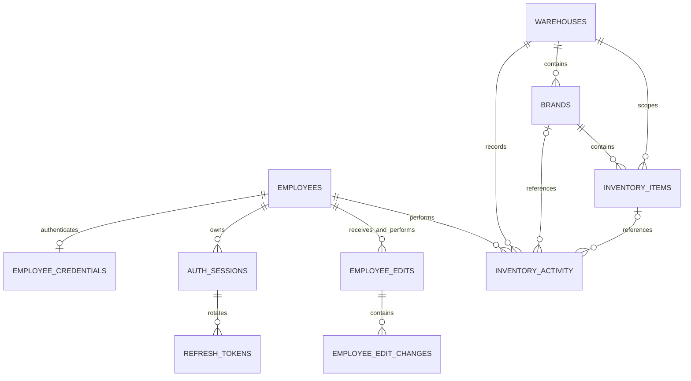

# Gstock Backend and Database Schema

This specification defines a modular monolith backend for the Gstock staff workspace, with PostgreSQL, server-side password hashing, JWT access tokens, and rotating refresh tokens. It covers the current employee, warehouse, brand, inventory, activity, and reporting workflows. This is a proposed design; it does not represent an implemented authentication service or database migration.

## Scope and design assumptions

The frontend supports staff sign-in, an employee profile card, searchable employee accounts and audited edits, warehouse and brand creation, stock item creation, quantity adjustments, activity history, and stock movement reports. Its existing persistence and password verification are browser-based preview behavior.

The design assumes one organisation and shared warehouse visibility for authenticated employees. JWT authentication, refresh-token management, account status, and the internal employee-management permission are backend additions. Departments, job titles, and bin locations remain text fields because the current forms do not manage separate lookup records.

Source model: the employee, inventory, and report types; employeeAccounts, employeePasswords, inventoryStore, and reports data logic; and the App, Workspace, EmployeeAccounts, Inventory, Warehouses, and Reports components examined for the original specification.

## Modular monolith architecture

Deploy one backend application with one PostgreSQL database. Organise its code into modules with explicit interfaces and table ownership. Module calls stay in process. Independent network services and a message broker are unnecessary for the present workflows.

| Module | Owns | Public responsibilities |
| --- | --- | --- |
| Authentication | employee_credentials, auth_sessions, refresh_tokens | Password verification, JWT issuance and validation, refresh rotation, revocation |
| Employees | employees, employee_edits, employee_edit_changes | Employee directory, current permissions, profile updates and audited password-change requests |
| Warehouses | warehouses | Warehouse creation, details, and search |
| Brands | brands | Brands scoped to warehouses and brand search |
| Inventory | inventory_items | Item creation, stock status, stock counts, quantity adjustments |
| Activity | inventory_activity | Append and read warehouse, brand, item, and quantity events |
| Reports | No authoritative tables | Read-only aggregation of activity and approved catalogue projections |

### Module boundaries and dependencies

Each module has API, application, domain, and infrastructure layers. Controllers validate request shape and call application services. Domain code contains business rules. Infrastructure contains database repositories and cryptographic adapters. Keep business rules out of controllers and React components.

Expose interfaces such as EmployeeDirectory, CredentialService, WarehouseDirectory, BrandDirectory, InventoryService, ActivityRecorder, and StockReportReader. A module must not write another module's tables or import its private repositories. Reports may query explicitly published read-only views/projections; report queries cannot mutate stock or audit history. Database foreign keys enforce consistency without granting unrestricted code access.

Authentication reads employee status through EmployeeDirectory. Brands reads warehouse identity through WarehouseDirectory. Inventory checks a brand and its warehouse through BrandDirectory. Catalogue and inventory commands call ActivityRecorder. Reports depends only on approved read contracts. Employees requests password hashing and revocation through Authentication's public credential interface.

To avoid circular implementation dependencies, define these contracts in a small application-contracts package. An application coordinator composes module services for cross-module workflows using one database connection and one transaction. For example, item creation and its Activity event commit together; an employee password change, credential update, edit history, and session revocation also commit together. Pass the same unit of work to participating services; do not make internal HTTP calls or independent commits.

Keep shared infrastructure limited to database transactions, validation primitives, IDs, time, error contracts, and request identity. Test or lint module imports to enforce allowed dependencies. No Redis dependency is required for this design.

### Suggested source structure

```text
src/
  app/                 composition, HTTP pipeline, coordinators
  contracts/           public module interfaces and data contracts
  modules/
    authentication/    api, application, domain, infrastructure
    employees/         api, application, domain, infrastructure
    warehouses/        api, application, domain, infrastructure
    brands/            api, application, domain, infrastructure
    inventory/         api, application, domain, infrastructure
    activity/          api, application, domain, infrastructure
    reports/           api, application, domain, infrastructure
  shared/              transactions, IDs, time, errors
  migrations/          ordered database migrations
```

## Password hashing and JWT authentication

Hash passwords on the server with Argon2id through a maintained password-hashing library. Store its encoded hash string, including salt, version, and cost parameters. Use a fresh random salt of at least 16 bytes per password. As a minimum starting configuration, use 19 MiB of memory, two iterations, and parallelism one, then benchmark and increase the cost where practical. Rehash after a successful login when the stored parameters are weaker than the configured policy. These baseline parameters follow OWASP Password Storage guidance.

Validate new passwords at 8–128 characters to match the current form. Do not trim or silently truncate passwords. Never store plaintext passwords, reversible encryption, password confirmations, or password material in audit events or logs. The browser's PBKDF2 verifier is not the server credential format; provision real credentials through a controlled process.

### Token policy

JWT access tokens authenticate ordinary API requests. Refresh tokens are opaque random secrets, not JWTs. The following lifetimes are proposed application defaults and can be configured independently of the cited security standards.

| Property | Proposed policy | Storage or behavior |
| --- | --- | --- |
| Access token | Signed JWT with 10 minute lifetime | React memory only; Authorization Bearer header |
| Signing algorithm | RS256 with configured key allowlist | Private key held in server secret storage |
| Refresh token | At least 32 random bytes; rotate on every use | Secure HttpOnly cookie; only SHA256 digest stored in database |
| Standard sign-in | 8 hour absolute session; 1 hour inactivity limit | Session cookie without persistent Max Age |
| Remember me | 30 day absolute session; 7 day inactivity limit | Persistent refresh cookie capped at absolute expiry |
| Permission checks | Current employee status and permissions | Read server state; do not trust an editable job title |
| Logout and password changes | Revoke the applicable session families | Check revocation on every protected request |

SHA256 is used only to fingerprint high-entropy random refresh secrets. Passwords use Argon2id. Never return a refresh token in a JSON body or put access or refresh tokens in localStorage, sessionStorage, URLs, or application logs. Return token responses with Cache Control no store.

Use the refresh cookie name __Host-gstock-refresh, with Secure, HttpOnly, SameSite Strict, Path /, and no Domain attribute. This assumes the frontend and API share an origin, using /api/v1. Clear it using matching attributes. A cross-origin deployment requires an explicit cookie, CORS, and CSRF review rather than enabling unrestricted credentials.

### JWT claims and verification

| Claim or header | Meaning | Validation |
| --- | --- | --- |
| alg | RS256 | Pin the permitted algorithm; reject unsigned and unexpected algorithms |
| kid | Signing key identifier | Resolve only a configured trusted key; never follow token-supplied key URLs |
| typ | at+jwt | Require the expected access-token type |
| iss | Configured Gstock issuer | Must exactly match configured issuer |
| aud | gstock-api | Must include the expected API audience |
| sub | Internal employee UUID | Must identify an existing active employee |
| sid | auth_sessions.id UUID | Session must belong to sub and be active and unexpired |
| jti | Unique access-token identifier | Generate for each JWT; not a refresh credential |
| iat and exp | Issued and expiry times in Unix seconds | Require valid times and bounded 10 minute lifetime; at most 30 seconds clock tolerance |

Use a maintained JWT library to verify the signature and required claims before trusting them. Tokens are signed, not encrypted: exclude passwords, email addresses, and other unnecessary profile data. JWT times use seconds; report bucket timestamps continue to use milliseconds. Rotate signing keys with a controlled overlap sufficient for existing access-token expiry. Keep private keys outside source code and database tables.

This design deliberately checks session and employee state on each protected request. It uses JWTs but is not fully stateless. That check makes logout, account deactivation, permission changes, and password-change revocation effective for existing access tokens. A valid signature alone is insufficient; fail closed if the state check cannot complete. A purely stateless variant would allow previously issued tokens until expiry and is not the behavior specified here.

### Sign in refresh and logout flows

1. Login validates email/password, checks an active account, and verifies the Argon2id hash. Return one generic failure message for invalid credentials. Rate limit attempts by account identifier and source; never reveal whether an account exists.
2. On success create an auth_sessions row and the first refresh_tokens row. Set the refresh cookie and return accessToken, tokenType Bearer, expiresIn 600, the employee profile, and effective permissions.
3. Send the JWT as Authorization Bearer on API requests. On page reload, use the refresh cookie to obtain an access token before calling /auth/me; no access token survives in browser storage.
4. Refresh locks the session and presented token rows in a transaction. Verify the digest, account, session expiry, token expiry, and token state. Mark the old token consumed, insert its successor, update last-refreshed and idle expiry without extending absolute expiry, then commit before returning a new JWT and setting the new refresh cookie.
5. Reuse of a consumed refresh token revokes the whole session family. Commit that revocation before returning 401; do not roll it back as part of exception handling. Retain consumed-token digests through family expiry so reuse can be detected. This rotation model follows the replay-detection principle in RFC 9700; this custom staff login is not a full OAuth authorisation server.
6. Logout revokes the current family and clears its refresh cookie. Logout all or an employee password change revokes every family for that employee. Existing access tokens then fail their sid state check. Clear the frontend's access token and profile immediately.

Serialise refreshes in the client, including across tabs through browser coordination. Strict reuse detection means a lost refresh response or duplicate refresh request can force sign-in again; never silently accept a consumed token. An expired or invalid refresh clears the cookie and returns the user to sign-in. Retry an ordinary API request at most once after refresh; explicitly resume a mutation only if the original 401 occurred before business processing. Do not automatically replay a stock mutation after a network timeout.

Validate allowed Origin and require JSON on login. Protect refresh, logout, and logout-all against CSRF with Origin checks and a signed double-submit CSRF cookie/header bound to the session family. The CSRF cookie is readable by the frontend; the refresh cookie remains HttpOnly. A same-origin GET /auth/csrf can return the CSRF value for a valid refresh session before the first refresh after reload; it never issues credentials or changes authentication state. Do not enable cross-origin reads of this endpoint. Apply a strict CORS allowlist if CORS is needed.

## Database relationships



A brand belongs to one warehouse. Reusing a brand name in a different warehouse creates a separate brand record. An item belongs to one brand and has one location and quantity. This model has no shared product catalogue or stock transfers.

### Shared database conventions

- Primary keys are backend-generated UUIDs and remain strings in JSON. Normalise human-readable identifiers separately.
- Use foreign keys with ON DELETE RESTRICT for business and audit records. No delete workflow exists in the current frontend.
- Use timestamptz and server-generated timestamps; return ISO 8601 strings. Display and report buckets use Africa/Johannesburg.
- Trim ordinary text; required text must be nonblank. Passwords are exempt from trimming. Optional blank values become null where marked nullable.
- Column names use snake_case; API fields use camelCase. created_at and updated_at are server-managed; update updated_at on every applicable mutation.
- Tables below use PostgreSQL types. Authentication lifecycle writes and business audit writes must be transactional. Never store issued access JWTs in a database table.

### 1 employees

| Column | Type | Rules and purpose |
| --- | --- | --- |
| id | uuid | Primary key; profile.id |
| employee_id | varchar(32) | Required employee number; case-insensitive unique |
| full_name | varchar(100) | Required |
| email | varchar(254) | Required valid email; case-insensitive unique |
| department | varchar(80) | Required free text |
| role | varchar(80) | Required display job title |
| can_manage_employee_accounts | boolean | Required; default false; internal permission |
| is_active | boolean | Required; default true; internal account status |
| created_at | timestamptz | Required; server-generated |
| updated_at | timestamptz | Required; server-managed |

Create unique indexes on lower(email) and lower(employee_id). Job title is not an authority source. Ordinary profile updates cannot set permissions or is_active; provision authorised managers and status changes through an administrative process. An inactive account cannot sign in, refresh, or use existing access tokens.

### 2 employee credentials

| Column | Type | Rules and purpose |
| --- | --- | --- |
| employee_id | uuid | Primary key and FK to employees.id |
| password_hash | text | Required encoded Argon2id hash with salt and parameters |
| password_changed_at | timestamptz | Required; server-generated |

This employee_id is the internal account UUID, not the employee number. An account without credentials cannot sign in. Never return credential data with an employee profile. Rehashing with stronger parameters does not by itself represent a user password change or trigger a password-change audit entry.

### 3 authentication sessions

Table name: auth_sessions. One row represents one sign-in and its entire refresh-token family, not one individual access token.

| Column | Type | Rules and purpose |
| --- | --- | --- |
| id | uuid | Primary key; JWT sid and refresh family ID |
| employee_id | uuid | Required FK to employees.id |
| remember_me | boolean | Required; lifetime policy chosen at login |
| created_at | timestamptz | Required |
| last_refreshed_at | timestamptz | Required; initially created_at |
| absolute_expires_at | timestamptz | Required; fixed at login |
| idle_expires_at | timestamptz | Required; refreshed up to absolute expiry |
| revoked_at | timestamptz | Nullable; non-null invalidates the entire family |
| revocation_reason | varchar(40) | Nullable; logout, logout-all, password-change, token-reuse, or admin |

Enforce created_at <= last_refreshed_at <= idle_expires_at <= absolute_expires_at. Reject a session at or beyond either expiry. Index employee_id and absolute_expires_at. Active access tokens require an active session belonging to the JWT sub; no access-token blocklist or Redis service is necessary.

### 4 refresh tokens

Table name: refresh_tokens. Keep the whole rotation chain until the family expires, including consumed digests.

| Column | Type | Rules and purpose |
| --- | --- | --- |
| id | uuid | Primary key |
| session_id | uuid | Required FK to auth_sessions.id |
| token_hash | char(64) | Required unique lowercase hexadecimal SHA256 digest |
| created_at | timestamptz | Required |
| expires_at | timestamptz | Required; no later than session absolute expiry |
| consumed_at | timestamptz | Nullable; set exactly once on successful rotation |
| replaced_by_token_id | uuid | Nullable; points to the successor token in the same session |

Add UNIQUE(id, session_id) and a self FK (replaced_by_token_id, session_id) to (id, session_id), declared DEFERRABLE INITIALLY DEFERRED, plus a check that the successor is not the same row. Require consumed_at and replaced_by_token_id to be both null or both populated; consumed time must fall within token validity. Add a partial unique index on session_id where consumed_at is null so each family has at most one unconsumed token. While holding the family lock, allocate the successor UUID, update the old row's consumed_at and replaced_by_token_id, then insert the successor. The deferred FK resolves at commit, while the partial index enforces the one-current-token rule. Roll back the whole transaction on any failure.

Set token expiry to the applicable idle deadline capped by the absolute deadline. Revoke through the family row. Index session_id and expires_at. Do not purge consumed rows while their family can still be active. Cleanup expired families and their chain in a maintenance transaction after all associated access tokens have expired. Refresh is serialized by locking the family row, which also coordinates logout and password-change revocation.

### 5 warehouses

| Column | Type | Rules and purpose |
| --- | --- | --- |
| id | uuid | Primary key |
| name | varchar(100) | Required; unique normalised name |
| contact_name | varchar(100) | Nullable |
| contact_email | varchar(254) | Nullable; valid email if provided |
| notes | varchar(1000) | Nullable |
| created_at | timestamptz | Required |
| updated_at | timestamptz | Required |

Warehouse location is not a separate address field in the current form. The stock item's location represents a bin or shelf code such as A-01-01.

### 6 brands

| Column | Type | Rules and purpose |
| --- | --- | --- |
| id | uuid | Primary key |
| warehouse_id | uuid | Required FK to warehouses.id |
| name | varchar(100) | Required; normalised name unique within warehouse |
| description | varchar(250) | Required; default empty string |
| created_at | timestamptz | Required |
| updated_at | timestamptz | Required |

Index warehouse_id. Add UNIQUE(id, warehouse_id) for composite foreign keys. Derive initials for API display from the first letters of the first two words, uppercased; do not store a second authoritative value.

### 7 inventory items

Table name: inventory_items.

| Column | Type | Rules and purpose |
| --- | --- | --- |
| id | uuid | Primary key |
| brand_id | uuid | Required; part of scoped FK below |
| warehouse_id | uuid | Required FK to warehouses.id; derived from brand |
| sku | varchar(40) | Nullable; normalised SKU unique within warehouse |
| name | varchar(100) | Required |
| location | varchar(80) | Required bin or shelf text |
| quantity | integer | Required; 0 to 1,000,000,000 inclusive |
| unit | varchar(5) | Required; units, boxes, rolls, cases, or pairs |
| reorder_level | integer | Required; 0 to 1,000,000,000 inclusive |
| created_at | timestamptz | Required |
| updated_at | timestamptz | Required |

Use FK (brand_id, warehouse_id) to brands(id, warehouse_id). The API accepts brandId and derives warehouseId; the duplicate ownership column supports database-enforced SKU uniqueness. Add UNIQUE(id, brand_id, warehouse_id) for scoped activity references. Index brand_id and warehouse_id.

Normalise warehouse names, brand names, and SKUs by trimming, collapsing repeated whitespace, and lowercasing. Use generated keys or expression indexes for concurrency-safe uniqueness. Blank SKU becomes null; multiple absent SKUs are allowed. Item names and locations are not unique. Quantities and reorder levels are whole numbers; there is no unit conversion.

Stock status is derived rather than stored:

```text
quantity = 0                  => out-of-stock
0 < quantity <= reorderLevel => low-stock
quantity > reorderLevel      => in-stock
```

### 8 inventory activity

Table name: inventory_activity. Append-only history supplies both the activity screen and reports.

| Column | Type | Rules and purpose |
| --- | --- | --- |
| id | uuid | Primary key |
| type | varchar(20) | warehouse-created, brand-created, item-created, quantity-updated |
| warehouse_id | uuid | Required FK to warehouses.id |
| brand_id | uuid | Nullable; scoped FK to brands(id, warehouse_id) |
| item_id | uuid | Nullable; scoped FK to inventory_items(id, brand_id, warehouse_id) |
| entity_name | varchar(100) | Required display-name snapshot |
| actor_id | uuid | Required FK to employees.id; resolved from authenticated identity |
| actor_employee_id | varchar(32) | Required employee-number snapshot |
| actor_full_name | varchar(100) | Required actor-name snapshot |
| occurred_at | timestamptz | Required server timestamp |
| reason | varchar(500) | Optional for warehouse/brand creation; required for stock events |
| previous_quantity | integer | Nullable; bounded as quantity |
| quantity | integer | Nullable; bounded as quantity |
| unit | varchar(5) | Nullable; same allowed values as items |

Event-specific constraints:

- warehouse-created has no brand, item, quantities, or unit.
- brand-created requires a brand; item, quantities, and unit are null.
- item-created requires brand, item, quantity, and unit; previous quantity is null and reason is Opening stock, including when opening quantity is zero.
- quantity-updated requires brand, item, old/new quantities, unit, and a nonblank reason; quantities must differ.

Require brand_id whenever item_id is populated. Derive API entityId from the appropriate warehouse, brand, or item FK by event type. Preserve actor, entity name, unit, and quantity snapshots. Index occurred_at and the warehouse, brand, and item IDs each paired with occurred_at. The Activity module alone appends rows; ordinary API operations cannot rewrite or delete history.

### 9 employee edits

Table name: employee_edits.

| Column | Type | Rules and purpose |
| --- | --- | --- |
| id | uuid | Primary key |
| target_employee_id | uuid | Required FK to employees.id |
| edited_by_id | uuid | Required FK to employees.id; authenticated actor |
| editor_employee_id | varchar(32) | Required employee-number snapshot |
| editor_full_name | varchar(100) | Required name snapshot |
| editor_role | varchar(80) | Required display-role snapshot |
| edited_at | timestamptz | Required server timestamp |
| password_changed | boolean | Required; default false |

Index (target_employee_id, edited_at). Password-only edits have no field-change rows and password_changed=true. Reject a change that updates neither profile fields nor a password. Preserve snapshots when employees later change names or roles.

### 10 employee edit changes

Table name: employee_edit_changes.

| Column | Type | Rules and purpose |
| --- | --- | --- |
| edit_id | uuid | FK to employee_edits.id; composite primary key |
| field | varchar(20) | employeeId, fullName, department, role, or email; composite primary key |
| before_value | text | Required previous value |
| after_value | text | Required new value; different from before_value |

Primary key is (edit_id, field). Never store passwords or hashes here. Map values to before and after in each edit's changes array.

## API contract

All routes are under /api/v1. Protected routes require a verified Bearer access token and current session/account checks. Login, refresh, and CSRF bootstrap use the special rules above rather than a valid access JWT. Logout accepts the current Bearer identity or a validated refresh family plus CSRF protection, so an expired access token does not prevent logout. Employee updates require the internal employee-management permission. Inventory actions require an active authenticated employee.

| Method | Path | Purpose and contract |
| --- | --- | --- |
| POST | /auth/login | email, password, rememberMe; JWT response and refresh cookie |
| GET | /auth/csrf | CSRF bootstrap for a valid refresh session; same origin only |
| POST | /auth/refresh | Refresh cookie and CSRF header; rotate token and return new JWT |
| POST | /auth/logout | Revoke current family; clear cookie; idempotent 204 |
| POST | /auth/logout-all | Valid JWT and CSRF protection; revoke all employee families |
| GET | /auth/me | Current EmployeeProfile and effective permissions |
| GET | /employees | Search name, employee number, email, department, role; paginate |
| GET | /employees/:id | Password-free EmployeeProfile |
| PATCH | /employees/:id | Editable profile fields and optional new password; audit and revoke on password change |
| GET | /employees/:id/edits | Edit history with nested field changes; paginate |
| GET | /warehouses | Search name/contact/email; paginate; brand and item counts |
| POST | /warehouses | name, contactName?, contactEmail?, notes? |
| GET | /warehouses/:id | Warehouse details and counts |
| GET | /brands | query, status, warehouseId; paginate; stock attention counts |
| POST | /brands | warehouseId, name, description |
| GET | /brands/:id | Brand details, warehouse, and stock summary |
| GET | /items | query, status, warehouseId, brandId; paginate |
| POST | /items | brandId, sku?, name, location, quantity, unit, reorderLevel |
| GET | /items/:id | Item details |
| POST | /items/:id/adjustments | mode, quantity, expectedQuantity, reason |
| GET | /inventory/summary | Optional brandId scope; overview counts |
| GET | /inventory/activity | warehouseId, brandId, itemId, type, from, to; latest first |
| GET | /reports/stock | amount, period, warehouseId, brandId, unit; aggregated points |

Login and refresh return accessToken, tokenType Bearer, expiresIn 600, profile, and permissions, with refresh delivered only as a cookie. Use 401 for invalid/expired access tokens and invalid refresh credentials; 403 for insufficient permissions or failed CSRF validation; 429 for throttled authentication. A 403 must not trigger automatic refresh. Never encode passwords or refresh tokens in API examples or logs.

List responses use items, page, pageSize, pageCount, total, start, and end. Default page size is 20; allow 10, 20, 50, or 100. Use a stable ID tie-breaker. Warehouses, brands, and items sort by name; employees may retain provisioning order by created_at and id. Paginate activity and employee history; aggregate reports from the full filtered event set.

Search is case-insensitive substring matching. Inventory search covers item name, SKU, location, brand name/description, and warehouse name. A brand group matches status when at least one child item matches; text may match its brand, warehouse, or an item. The all filter means no constraint.

Summary fields are brands, itemLines, lowStock, outOfStock, and needsAttention, where needsAttention=lowStock+outOfStock. Brand detail includes the distinct count of storage locations. Never sum quantities across different units.

Creation returns 201 with the entity. Adjustments return 200 with the updated item and activity event. Employee updates return the profile and edit record. Logout returns 204. Error shape is error containing code, message, and optional field. Use 400 for malformed requests, 404 for missing entities, 409 for duplicates or stale quantities, and 422 for invalid fields or no-op changes. Authentication failures occur before executing business commands.

## Transaction and permission rules

For a stock adjustment:

1. Authenticate and authorise the actor. Validate mode add/remove/set, integer input in range, expectedQuantity, and a nonblank reason up to 500 characters.
2. Begin a transaction, lock the item, and compare its current quantity with expectedQuantity. A mismatch returns 409 with no mutation.
3. Calculate the new quantity: add means current+input; remove means current-input; set means input. Reject negative, out-of-range, or unchanged results.
4. Update the item and append its old/new quantity event through ActivityRecorder in the same transaction and connection.
5. Commit both writes before responding. Roll back the quantity if the activity write fails.

Comparing expectedQuantity matches the frontend. If detecting changes that return to the same count becomes necessary, add a version field to both the item and the form contract. Do not treat the browser InventoryState.version as a concurrency field.

Warehouse, brand, and item creation append their activity in the same transaction. Profile updates serialise changes to the target employee so before/after values are accurate. Password updates atomically save the Argon2id hash, password_changed flag, edit details, and revocation of all target employee sessions. Password-change and account-status operations coordinate locks with login/refresh so a concurrent request cannot revive a revoked family. Define a consistent employee-then-session lock order.

Resolve actor IDs, names, timestamps, permissions, and session ownership on the server. Reject attempts to set them through form payloads. Blank/omitted new password preserves the current credential. Editing a display role never changes authority. Admin permission and status changes are outside the ordinary employee form.

## Report contract and calculations

Example request: GET /api/v1/reports/stock with amount=1, period=months, warehouseId=all, brandId=all, and unit=units. Require the same JWT and session checks as other protected reads.

```typescript
type StockReportResponse = {
  start: string
  end: string
  interval: 'hour' | 'day' | 'week' | 'month'
  points: Array<{
    timestamp: number // Unix milliseconds at bucket start
    label: string
    fullLabel: string
    newStock: number
    added: number
    subtracted: number
  }>
  summary: {
    newItems: number
    newStock: number
    added: number
    subtracted: number
    updates: number
  }
}
```

- Support rolling days/weeks and calendar months/years. Maximum amounts are 365 days, 52 weeks, 12 months, or one year; minimum one. Default to one month and clamp calendar subtraction at month end.
- End is server now. Bucket in Africa/Johannesburg: hour for windows up to two days, day up to 62 days, week up to 180 days, otherwise month. Weeks start Monday.
- Include events within the requested start/end inclusive. Return zero-valued gaps and buckets containing the start and end, even when the first bucket starts before the window.
- item-created increments newItems and adds its opening quantity to newStock. A zero opening quantity still counts as a new item.
- quantity-updated uses quantity minus previous_quantity. Positive deltas contribute to added; absolute negative deltas contribute to subtracted. updates counts nonzero quantity changes.
- Return subtracted as a positive magnitude; the chart draws it below zero. Net movement for existing items is added minus subtracted, excluding opening stock.
- Filter on recorded warehouse, brand, and unit. Always select one unit; do not combine boxes, units, rolls, cases, and pairs.
- Reports have no authoritative table. Read activity projections; introduce caches only when measured volume requires them.

## Frontend integration and boundaries

- Replace browser credential checks with /auth/login. Keep only the access JWT in memory. On reload fetch a CSRF value, refresh once, then fetch current profile/permissions. Coordinate refresh across concurrent requests and tabs.
- Replace local employee and inventory persistence adapters with async API services. Save forms must await results and refresh affected lists, totals, and history.
- /auth/me returns profile id, employeeId, fullName, email, department, and role, plus separate permissions. Never return password_hash, passwordVerifier, or refresh secrets. Preserve the existing password-free card shape.
- Read edit history separately or assemble profile plus editHistory when adapting the current EmployeeAccount type. Map activity into nested actor and derived entityId, and edits into editedBy and changes.
- Remove the any-password preview fallback and the all-employees-can-edit preview flag. Hide restricted controls using returned permissions and enforce the same rules on the server.
- Remember me selects refresh-family lifetime and cookie persistence; it never changes access-token storage or stores passwords. Sign-out clears memory, revokes the family, and clears the refresh cookie.
- Existing sample IDs include non-UUID strings. Provision new UUIDs or use a consistent mapping for intentional imports. Browser storage version is a migration marker, not a database column.
- Sample stock has no recorded opening history. Import balances with an explicit opening event at import time if they must appear in reports; do not fabricate prior movements.
- Theme preference can remain local. Employee creation, account deletion, item metadata editing, stock transfers, suppliers, customers, purchasing, sales, costs, valuation, and multiple organisations have no current workflows and are outside this schema. Provision initial employees through an administrative process.

## Verification requirements

Implementation checks must cover correct and wrong passwords; unique salts; inactive accounts; JWT signature, algorithm, audience, issuer, expiry, and sid rejection; current permissions; refresh rotation; reuse revocation committed on failure; concurrent refresh; logout; password-change revocation; cookie attributes; CSRF; throttling; and absence of credentials from responses/logs.

Business checks must cover warehouse-scoped SKU uniqueness, cross-warehouse FK consistency, stale quantities, negative/no-op stock updates, rollback of an item update when audit insertion fails, accurate employee edit history, unit-separated reports, and SAST or import-rule checks for module boundaries. This document specifies those checks; it does not claim they have been implemented or passed.

## Security references

OWASP Password Storage Cheat Sheet supports the Argon2id baseline and encoded salted password-hash approach. https://cheatsheetseries.owasp.org/cheatsheets/Password_Storage_Cheat_Sheet.html

RFC 8725 JSON Web Token Best Current Practices supports pinned algorithms, trusted keys, and issuer/audience validation. https://www.rfc-editor.org/rfc/rfc8725.html

RFC 9700 OAuth Security Best Current Practice describes refresh-token rotation and replay detection. Its lifecycle principles inform this design; the custom staff authentication API is not an implementation of the OAuth grant flows. https://www.rfc-editor.org/rfc/rfc9700.html

The specific token lifetimes, RS256 choice, PostgreSQL schema, module boundaries, and per-request revocation lookup are Gstock design decisions, not requirements attributed to those references.
