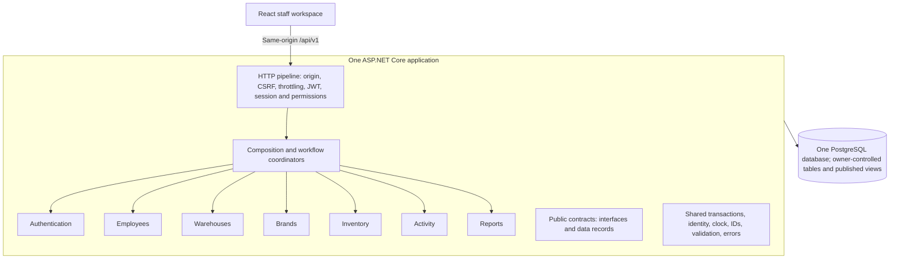

# Gstock backend diagram and complete proposed file map

C# / ASP.NET Core modular monolith, based on `../Gstock Backend and Database Schema.docx`. This is a design artifact, not an implemented backend. The C# / ASP.NET Core choice comes from the user's request. Exact class splits, infrastructure choices and file names are proposed implementation decisions.

The [eight-page diagram](gstock-backend-diagram.pdf) shows the architecture and every proposed file. Open the [editable diagram](gstock-backend-diagram.drawio) in diagrams.net to edit individual shapes and labels. The [overview](gstock-backend-overview.svg) is a scalable image.

## Legend and scope

- `[D]` is a directory, also drawn with a blue folder symbol and a trailing slash.
- `[F]` is a file, also drawn with a document symbol and its real extension.
- The complete map contains **248 files** and **91 folders**, excluding the existing frontend and these diagram deliverables.
- Every listed path is explicit. DTO/contract files can contain multiple related C# records; no wildcard stands in for unlisted files.
- Generated output (`bin/`, `obj/`, publish output, coverage results), local `.env` values and secret signing keys are deliberately excluded from the source tree. `global.json` pins the selected supported SDK at implementation time; this design does not assert a specific SDK/package version.
- The application uses one ASP.NET Core host plus a small contracts assembly. Modules are folders inside the host project. Architecture tests enforce code boundaries; separate module assemblies are not required for this baseline.
- The proposed SQL approach uses Npgsql and parameterized queries with ordered SQL migrations; it does not require EF Core DbContexts or EF-generated migration classes. Use one SQL migration runner within the administration command and embed the ordered scripts in the backend assembly.
- `Program.cs` selects HTTP mode or explicit management mode. Management mode does not start HTTP listeners. Migration, provisioning, account status changes and expired-session cleanup remain administrative operations.

## Architecture



Each module has four layers: `Api/` handles HTTP requests, request validation and response mapping; `Application/` implements use cases and repository/adapter ports; `Domain/` contains entities and business rules; `Infrastructure/` implements persistence, cryptographic adapters and published projections. Domain code does not depend on ASP.NET Core, SQL adapters or another module's implementation.

## Complete file-and-folder tree

```text
[D] g-stock/
|-- [D] .github/
|   `-- [D] workflows/
|       `-- [F] backend-ci.yml
`-- [D] backend/
    |-- [D] deploy/
    |   `-- [F] nginx.conf
    |-- [D] docs/
    |   |-- [F] module-boundaries.md
    |   |-- [F] openapi.yaml
    |   `-- [F] operations.md
    |-- [D] migrations/
    |   |-- [F] 001_employees.sql
    |   |-- [F] 002_authentication.sql
    |   |-- [F] 003_warehouses.sql
    |   |-- [F] 004_brands.sql
    |   |-- [F] 005_inventory_items.sql
    |   |-- [F] 006_inventory_activity.sql
    |   |-- [F] 007_employee_audit.sql
    |   |-- [F] 008_published_read_views.sql
    |   `-- [F] 009_database_roles.sql
    |-- [D] src/
    |   |-- [D] Gstock.Backend/
    |   |   |-- [D] App/
    |   |   |   |-- [D] Administration/
    |   |   |   |   |-- [F] AdminCommandRunner.cs
    |   |   |   |   |-- [F] ChangeAccountStatusCommand.cs
    |   |   |   |   |-- [F] CleanupAuthSessionsCommand.cs
    |   |   |   |   |-- [F] MigrateDatabaseCommand.cs
    |   |   |   |   `-- [F] ProvisionEmployeeCommand.cs
    |   |   |   |-- [D] Composition/
    |   |   |   |   |-- [F] ModuleRegistration.cs
    |   |   |   |   `-- [F] ServiceRegistration.cs
    |   |   |   |-- [D] Configuration/
    |   |   |   |   |-- [F] AuthOptions.cs
    |   |   |   |   |-- [F] DatabaseOptions.cs
    |   |   |   |   `-- [F] OriginOptions.cs
    |   |   |   |-- [D] Coordinators/
    |   |   |   |   |-- [F] CatalogueCoordinator.cs
    |   |   |   |   |-- [F] EmployeeCoordinator.cs
    |   |   |   |   `-- [F] InventoryCoordinator.cs
    |   |   |   `-- [D] Http/
    |   |   |       |-- [F] AuthenticationSetup.cs
    |   |   |       |-- [F] CsrfEndpointFilter.cs
    |   |   |       |-- [F] EndpointPolicies.cs
    |   |   |       |-- [F] ExceptionHandler.cs
    |   |   |       |-- [F] HealthEndpoints.cs
    |   |   |       |-- [F] OriginValidationMiddleware.cs
    |   |   |       |-- [F] RateLimitingSetup.cs
    |   |   |       |-- [F] RequestIdentityMiddleware.cs
    |   |   |       `-- [F] RequestLoggingMiddleware.cs
    |   |   |-- [D] Modules/
    |   |   |   |-- [D] Activity/
    |   |   |   |   |-- [D] Api/
    |   |   |   |   |   |-- [F] ActivityController.cs
    |   |   |   |   |   |-- [F] ActivityDtos.cs
    |   |   |   |   |   |-- [F] ActivityRequestValidator.cs
    |   |   |   |   |   `-- [F] ActivityResponseMapper.cs
    |   |   |   |   |-- [D] Application/
    |   |   |   |   |   |-- [F] ActivityQueryService.cs
    |   |   |   |   |   |-- [F] ActivityRecorder.cs
    |   |   |   |   |   `-- [F] IActivityRepository.cs
    |   |   |   |   |-- [D] Domain/
    |   |   |   |   |   |-- [F] ActivityRules.cs
    |   |   |   |   |   |-- [F] ActivityType.cs
    |   |   |   |   |   `-- [F] InventoryActivity.cs
    |   |   |   |   |-- [D] Infrastructure/
    |   |   |   |   |   |-- [D] Projections/
    |   |   |   |   |   |   `-- [F] StockMovementView.sql
    |   |   |   |   |   `-- [F] PostgresActivityRepository.cs
    |   |   |   |   `-- [F] ActivityModule.cs
    |   |   |   |-- [D] Authentication/
    |   |   |   |   |-- [D] Api/
    |   |   |   |   |   |-- [F] AuthController.cs
    |   |   |   |   |   |-- [F] AuthDtos.cs
    |   |   |   |   |   |-- [F] AuthRequestValidator.cs
    |   |   |   |   |   `-- [F] RefreshCookieWriter.cs
    |   |   |   |   |-- [D] Application/
    |   |   |   |   |   |-- [F] AuthService.cs
    |   |   |   |   |   |-- [F] CredentialService.cs
    |   |   |   |   |   |-- [F] IAccessTokenService.cs
    |   |   |   |   |   |-- [F] ICredentialRepository.cs
    |   |   |   |   |   |-- [F] ICsrfTokenService.cs
    |   |   |   |   |   |-- [F] IPasswordHasher.cs
    |   |   |   |   |   |-- [F] IRefreshTokenGenerator.cs
    |   |   |   |   |   |-- [F] IRefreshTokenRepository.cs
    |   |   |   |   |   |-- [F] ISessionRepository.cs
    |   |   |   |   |   |-- [F] RefreshTokenService.cs
    |   |   |   |   |   |-- [F] SessionCleanupService.cs
    |   |   |   |   |   `-- [F] SessionValidator.cs
    |   |   |   |   |-- [D] Domain/
    |   |   |   |   |   |-- [F] AuthSession.cs
    |   |   |   |   |   |-- [F] EmployeeCredential.cs
    |   |   |   |   |   |-- [F] PasswordPolicy.cs
    |   |   |   |   |   |-- [F] RefreshToken.cs
    |   |   |   |   |   `-- [F] SessionLifetimePolicy.cs
    |   |   |   |   |-- [D] Infrastructure/
    |   |   |   |   |   |-- [F] Argon2idPasswordHasher.cs
    |   |   |   |   |   |-- [F] JwtAccessTokenService.cs
    |   |   |   |   |   |-- [F] JwtBearerHandler.cs
    |   |   |   |   |   |-- [F] PostgresCredentialRepository.cs
    |   |   |   |   |   |-- [F] PostgresRefreshTokenRepository.cs
    |   |   |   |   |   |-- [F] PostgresSessionRepository.cs
    |   |   |   |   |   |-- [F] RefreshTokenGenerator.cs
    |   |   |   |   |   |-- [F] SignedCsrfTokenService.cs
    |   |   |   |   |   `-- [F] SigningKeyProvider.cs
    |   |   |   |   `-- [F] AuthenticationModule.cs
    |   |   |   |-- [D] Brands/
    |   |   |   |   |-- [D] Api/
    |   |   |   |   |   |-- [F] BrandDtos.cs
    |   |   |   |   |   |-- [F] BrandRequestValidator.cs
    |   |   |   |   |   |-- [F] BrandResponseMapper.cs
    |   |   |   |   |   `-- [F] BrandsController.cs
    |   |   |   |   |-- [D] Application/
    |   |   |   |   |   |-- [F] BrandDirectory.cs
    |   |   |   |   |   |-- [F] BrandQueryService.cs
    |   |   |   |   |   |-- [F] BrandWriter.cs
    |   |   |   |   |   `-- [F] IBrandRepository.cs
    |   |   |   |   |-- [D] Domain/
    |   |   |   |   |   |-- [F] Brand.cs
    |   |   |   |   |   `-- [F] BrandRules.cs
    |   |   |   |   |-- [D] Infrastructure/
    |   |   |   |   |   |-- [D] Projections/
    |   |   |   |   |   |   `-- [F] BrandDirectoryView.sql
    |   |   |   |   |   `-- [F] PostgresBrandRepository.cs
    |   |   |   |   `-- [F] BrandsModule.cs
    |   |   |   |-- [D] Employees/
    |   |   |   |   |-- [D] Api/
    |   |   |   |   |   |-- [F] EmployeeDtos.cs
    |   |   |   |   |   |-- [F] EmployeeRequestValidator.cs
    |   |   |   |   |   |-- [F] EmployeeResponseMapper.cs
    |   |   |   |   |   `-- [F] EmployeesController.cs
    |   |   |   |   |-- [D] Application/
    |   |   |   |   |   |-- [F] EmployeeAdministrationService.cs
    |   |   |   |   |   |-- [F] EmployeeDirectory.cs
    |   |   |   |   |   |-- [F] EmployeeEditor.cs
    |   |   |   |   |   |-- [F] EmployeeQueryService.cs
    |   |   |   |   |   |-- [F] IEmployeeEditRepository.cs
    |   |   |   |   |   `-- [F] IEmployeeRepository.cs
    |   |   |   |   |-- [D] Domain/
    |   |   |   |   |   |-- [F] Employee.cs
    |   |   |   |   |   |-- [F] EmployeeEdit.cs
    |   |   |   |   |   |-- [F] EmployeeEditChange.cs
    |   |   |   |   |   `-- [F] EmployeeRules.cs
    |   |   |   |   |-- [D] Infrastructure/
    |   |   |   |   |   |-- [F] PostgresEmployeeEditRepository.cs
    |   |   |   |   |   `-- [F] PostgresEmployeeRepository.cs
    |   |   |   |   `-- [F] EmployeesModule.cs
    |   |   |   |-- [D] Inventory/
    |   |   |   |   |-- [D] Api/
    |   |   |   |   |   |-- [F] InventoryDtos.cs
    |   |   |   |   |   |-- [F] InventoryRequestValidator.cs
    |   |   |   |   |   |-- [F] InventoryResponseMapper.cs
    |   |   |   |   |   |-- [F] InventorySummaryController.cs
    |   |   |   |   |   `-- [F] ItemsController.cs
    |   |   |   |   |-- [D] Application/
    |   |   |   |   |   |-- [F] IInventoryRepository.cs
    |   |   |   |   |   |-- [F] InventoryQueryService.cs
    |   |   |   |   |   `-- [F] InventoryService.cs
    |   |   |   |   |-- [D] Domain/
    |   |   |   |   |   |-- [F] InventoryItem.cs
    |   |   |   |   |   |-- [F] InventoryRules.cs
    |   |   |   |   |   |-- [F] StockAdjustment.cs
    |   |   |   |   |   |-- [F] StockStatus.cs
    |   |   |   |   |   `-- [F] StockUnit.cs
    |   |   |   |   |-- [D] Infrastructure/
    |   |   |   |   |   |-- [D] Projections/
    |   |   |   |   |   |   `-- [F] InventoryCatalogueView.sql
    |   |   |   |   |   `-- [F] PostgresInventoryRepository.cs
    |   |   |   |   `-- [F] InventoryModule.cs
    |   |   |   |-- [D] Reports/
    |   |   |   |   |-- [D] Api/
    |   |   |   |   |   |-- [F] ReportDtos.cs
    |   |   |   |   |   |-- [F] ReportRequestValidator.cs
    |   |   |   |   |   |-- [F] ReportResponseMapper.cs
    |   |   |   |   |   `-- [F] ReportsController.cs
    |   |   |   |   |-- [D] Application/
    |   |   |   |   |   |-- [F] IStockMovementReader.cs
    |   |   |   |   |   `-- [F] StockReportService.cs
    |   |   |   |   |-- [D] Domain/
    |   |   |   |   |   |-- [F] ReportBucketPolicy.cs
    |   |   |   |   |   |-- [F] ReportWindow.cs
    |   |   |   |   |   `-- [F] StockMovementTotals.cs
    |   |   |   |   |-- [D] Infrastructure/
    |   |   |   |   |   `-- [F] PostgresStockMovementReader.cs
    |   |   |   |   `-- [F] ReportsModule.cs
    |   |   |   `-- [D] Warehouses/
    |   |   |       |-- [D] Api/
    |   |   |       |   |-- [F] WarehouseDtos.cs
    |   |   |       |   |-- [F] WarehouseRequestValidator.cs
    |   |   |       |   |-- [F] WarehouseResponseMapper.cs
    |   |   |       |   `-- [F] WarehousesController.cs
    |   |   |       |-- [D] Application/
    |   |   |       |   |-- [F] IWarehouseRepository.cs
    |   |   |       |   |-- [F] WarehouseDirectory.cs
    |   |   |       |   |-- [F] WarehouseQueryService.cs
    |   |   |       |   `-- [F] WarehouseWriter.cs
    |   |   |       |-- [D] Domain/
    |   |   |       |   |-- [F] Warehouse.cs
    |   |   |       |   `-- [F] WarehouseRules.cs
    |   |   |       |-- [D] Infrastructure/
    |   |   |       |   |-- [D] Projections/
    |   |   |       |   |   `-- [F] WarehouseDirectoryView.sql
    |   |   |       |   `-- [F] PostgresWarehouseRepository.cs
    |   |   |       `-- [F] WarehousesModule.cs
    |   |   |-- [D] Properties/
    |   |   |   `-- [F] launchSettings.json
    |   |   |-- [D] Shared/
    |   |   |   |-- [D] Errors/
    |   |   |   |   |-- [F] ApplicationException.cs
    |   |   |   |   `-- [F] ErrorResponse.cs
    |   |   |   |-- [D] Identity/
    |   |   |   |   `-- [F] CurrentRequestIdentity.cs
    |   |   |   |-- [D] Ids/
    |   |   |   |   `-- [F] UuidGenerator.cs
    |   |   |   |-- [D] Observability/
    |   |   |   |   `-- [F] LogRedaction.cs
    |   |   |   |-- [D] Persistence/
    |   |   |   |   |-- [F] DatabaseErrorMapper.cs
    |   |   |   |   |-- [F] PostgresConnectionFactory.cs
    |   |   |   |   |-- [F] PostgresUnitOfWork.cs
    |   |   |   |   `-- [F] SqlReadExecutor.cs
    |   |   |   |-- [D] Time/
    |   |   |   |   `-- [F] SystemClock.cs
    |   |   |   `-- [D] Validation/
    |   |   |       |-- [F] PaginationRules.cs
    |   |   |       `-- [F] TextNormalization.cs
    |   |   |-- [F] appsettings.Development.json
    |   |   |-- [F] appsettings.json
    |   |   |-- [F] Gstock.Backend.csproj
    |   |   `-- [F] Program.cs
    |   `-- [D] Gstock.Contracts/
    |       |-- [D] Activity/
    |       |   |-- [F] ActivityRecord.cs
    |       |   `-- [F] IActivityRecorder.cs
    |       |-- [D] Authentication/
    |       |   |-- [F] IAuthSessionMaintenance.cs
    |       |   |-- [F] ICredentialService.cs
    |       |   `-- [F] ISessionValidator.cs
    |       |-- [D] Brands/
    |       |   |-- [F] BrandCreateCommand.cs
    |       |   |-- [F] BrandSnapshot.cs
    |       |   |-- [F] IBrandDirectory.cs
    |       |   `-- [F] IBrandWriter.cs
    |       |-- [D] Common/
    |       |   |-- [F] ActorSnapshot.cs
    |       |   |-- [F] ErrorCodes.cs
    |       |   |-- [F] IClock.cs
    |       |   |-- [F] IIdGenerator.cs
    |       |   |-- [F] IRequestIdentity.cs
    |       |   |-- [F] IUnitOfWork.cs
    |       |   |-- [F] PageRequest.cs
    |       |   `-- [F] PageResult.cs
    |       |-- [D] Employees/
    |       |   |-- [F] EmployeeEditCommand.cs
    |       |   |-- [F] EmployeeEditResult.cs
    |       |   |-- [F] EmployeeSnapshot.cs
    |       |   |-- [F] IEmployeeAdministration.cs
    |       |   |-- [F] IEmployeeDirectory.cs
    |       |   `-- [F] IEmployeeEditor.cs
    |       |-- [D] Inventory/
    |       |   |-- [F] IInventoryService.cs
    |       |   |-- [F] InventorySnapshot.cs
    |       |   `-- [F] InventoryWriteCommands.cs
    |       |-- [D] Reports/
    |       |   |-- [F] IStockReportReader.cs
    |       |   `-- [F] StockReportContracts.cs
    |       |-- [D] Warehouses/
    |       |   |-- [F] IWarehouseDirectory.cs
    |       |   |-- [F] IWarehouseWriter.cs
    |       |   |-- [F] WarehouseCreateCommand.cs
    |       |   `-- [F] WarehouseSnapshot.cs
    |       |-- [D] Workflows/
    |       |   |-- [F] ICatalogueWorkflow.cs
    |       |   |-- [F] IEmployeeWorkflow.cs
    |       |   `-- [F] IInventoryWorkflow.cs
    |       `-- [F] Gstock.Contracts.csproj
    |-- [D] tests/
    |   |-- [D] Gstock.ArchitectureTests/
    |   |   |-- [F] Gstock.ArchitectureTests.csproj
    |   |   |-- [F] LayerDependencyTests.cs
    |   |   |-- [F] ModuleBoundaryTests.cs
    |   |   `-- [F] PublishedReadAccessTests.cs
    |   |-- [D] Gstock.IntegrationTests/
    |   |   |-- [D] Activity/
    |   |   |   `-- [F] ActivityHistoryTests.cs
    |   |   |-- [D] Authentication/
    |   |   |   |-- [F] CookieCsrfRateLimitTests.cs
    |   |   |   |-- [F] CredentialRedactionTests.cs
    |   |   |   |-- [F] JwtValidationTests.cs
    |   |   |   |-- [F] PasswordHashingTests.cs
    |   |   |   |-- [F] RefreshConcurrencyTests.cs
    |   |   |   |-- [F] RefreshRotationTests.cs
    |   |   |   `-- [F] SessionRevocationTests.cs
    |   |   |-- [D] Brands/
    |   |   |   `-- [F] BrandScopeQueryCreateTests.cs
    |   |   |-- [D] Database/
    |   |   |   `-- [F] MigrationAndViewTests.cs
    |   |   |-- [D] Employees/
    |   |   |   |-- [F] AccountStatusConcurrencyTests.cs
    |   |   |   |-- [F] EmployeePermissionAuditTests.cs
    |   |   |   `-- [F] PasswordChangeAtomicityTests.cs
    |   |   |-- [D] Fixtures/
    |   |   |   |-- [F] GstockApiFactory.cs
    |   |   |   |-- [F] PostgresFixture.cs
    |   |   |   `-- [F] TestIdentity.cs
    |   |   |-- [D] Inventory/
    |   |   |   |-- [F] ActivityRollbackTests.cs
    |   |   |   |-- [F] InventoryConstraintTests.cs
    |   |   |   |-- [F] ItemQueryCreateTests.cs
    |   |   |   `-- [F] StockConcurrencyTests.cs
    |   |   |-- [D] Reports/
    |   |   |   `-- [F] StockReportQueryTests.cs
    |   |   |-- [D] Warehouses/
    |   |   |   `-- [F] WarehouseQueryCreateTests.cs
    |   |   `-- [F] Gstock.IntegrationTests.csproj
    |   `-- [D] Gstock.UnitTests/
    |       |-- [D] Activity/
    |       |   `-- [F] ActivityRulesTests.cs
    |       |-- [D] Authentication/
    |       |   |-- [F] PasswordPolicyTests.cs
    |       |   `-- [F] SessionLifetimeTests.cs
    |       |-- [D] Employees/
    |       |   `-- [F] EmployeeEditRulesTests.cs
    |       |-- [D] Inventory/
    |       |   |-- [F] StockAdjustmentTests.cs
    |       |   `-- [F] StockStatusTests.cs
    |       |-- [D] Reports/
    |       |   |-- [F] StockMovementTotalsTests.cs
    |       |   `-- [F] StockReportBucketTests.cs
    |       `-- [F] Gstock.UnitTests.csproj
    |-- [F] .dockerignore
    |-- [F] .editorconfig
    |-- [F] .env.example
    |-- [F] .gitignore
    |-- [F] compose.yaml
    |-- [F] Dockerfile
    |-- [F] global.json
    |-- [F] Gstock.Backend.slnx
    `-- [F] README.md
```

## What the groups do

### Repository & deployment

Root: `g-stock/`

One backend image. PostgreSQL and a same-origin reverse proxy are deployment infrastructure. Secrets and signing keys are supplied externally.

### Application host

Root: `backend/src/Gstock.Backend/`

Program wires one ASP.NET Core host. Coordinators implement workflow contracts and own transactions for cross-module writes. Public health probes reveal no secrets.

### Shared infrastructure

Root: `backend/src/Gstock.Backend/Shared/`

Use Npgsql with parameterized SQL. A unit of work carries the same connection and transaction to participating repositories; read executors accept explicit published projections.

### Public contracts

Root: `backend/src/Gstock.Contracts/`

A separate assembly contains interfaces and data records only. Modules depend on it, never on another module's private repositories. Grouped DTO files contain related named records.

### Database & administration

Root: `backend/`

Management mode runs the same assembly without starting HTTP. Migrations use a privileged connection. Runtime and report-reader roles have restricted grants; migration history is tool-managed.

### Authentication

Root: `backend/src/Gstock.Backend/Modules/Authentication/`

Owns employee_credentials, auth_sessions and refresh_tokens. Verifies active employee/session state on protected requests; refresh locks the family and commits replay revocation before returning 401.

### Employees

Root: `backend/src/Gstock.Backend/Modules/Employees/`

Owns employees, employee_edits and employee_edit_changes. Profile writes require current management permission; passwords and hashes never enter response or audit DTOs.

### Warehouses

Root: `backend/src/Gstock.Backend/Modules/Warehouses/`

Owns warehouses. Creation goes through CatalogueCoordinator and appends Activity in the same transaction. Count queries use approved Inventory and Brands views.

### Brands

Root: `backend/src/Gstock.Backend/Modules/Brands/`

Owns brands. Warehouse identity comes from IWarehouseDirectory. Names are unique within a warehouse; initials and stock-attention counts are derived for responses.

### Inventory

Root: `backend/src/Gstock.Backend/Modules/Inventory/`

Owns inventory_items. Derives warehouse from brand. Lock item, compare expectedQuantity, validate bounds, and append Activity before committing. Stock status is derived.

### Activity

Root: `backend/src/Gstock.Backend/Modules/Activity/`

Owns append-only inventory_activity. Server identity supplies actor and timestamp snapshots. Module APIs expose append/read operations; history has no ordinary update or delete path.

### Reports

Root: `backend/src/Gstock.Backend/Modules/Reports/`

Owns no authoritative tables. A separate SELECT-only connection reads published views. Bucket in Africa/Johannesburg, fill gaps with zeros, and keep each report to one stock unit.

### Unit & architecture tests

Root: `backend/tests/`

Pure domain checks cover rules and calculations. Architecture checks enforce module ownership, layer dependencies and approved read access.

### Integration tests

Root: `backend/tests/`

These are planned checks, not claims of passing tests. Integration tests use real PostgreSQL semantics for locks, constraints, rollback, refresh replay and read-only grants.

## Dependency and transaction rules

| Consumer | Allowed public dependency | Reason |
| --- | --- | --- |
| Authentication | IEmployeeDirectory | Current employee identity, account status and permissions |
| Employees workflow | IEmployeeEditor + ICredentialService | Atomic profile/audit/credential changes and session revocation |
| Brands | IWarehouseDirectory | Verify warehouse ownership |
| Inventory | IBrandDirectory | Verify brand and derive warehouse |
| Catalogue coordinator | IWarehouseWriter + IBrandWriter + IActivityRecorder | Catalogue creation and matching history commit together |
| Inventory coordinator | IInventoryService + IActivityRecorder | Item/quantity change and history commit together |
| Reports | Published Activity/catalogue views | Read-only aggregation with an explicitly SELECT-only database role |
| Catalogue query services | Explicitly published directory/catalogue views | Counts and cross-module search without private-table access |
| Composition root | Module registration entry points | Register module implementations; no business decisions here |

Request flow: controller -> owning application service or workflow interface -> domain rules -> module-owned repository. Coordinators receive module contracts through dependency injection. Only App composition code imports module registration entry points. Private cross-module imports fail the architecture checks.

`PostgresUnitOfWork` implements the `IUnitOfWork` contract. A coordinator begins the connection/transaction, passes the same unit of work to every writer, then commits once. Repositories never create independent commits inside a workflow. Authentication owns transactions for login and refresh; Employees owns atomic profile/audit operations when a coordinator passes its transaction. Cross-cutting code handles transaction mechanics, not business rules.

### Stock adjustment

```mermaid
sequenceDiagram
    participant API as ItemsController
    participant CO as InventoryCoordinator
    participant INV as IInventoryService
    participant ACT as IActivityRecorder
    participant DB as PostgreSQL / same transaction
    API->>CO: Adjust item with expectedQuantity
    CO->>DB: BEGIN
    CO->>INV: Apply adjustment (same unit of work)
    INV->>DB: Lock item; compare expectedQuantity; update
    INV-->>CO: Previous/new values and item snapshot
    CO->>ACT: Append actor + old/new stock event
    ACT->>DB: INSERT inventory_activity
    CO->>DB: COMMIT both writes
    CO-->>API: Updated item and activity
    Note over CO,DB: Any failure before commit rolls back both writes
```

Employee profile/password workflow: lock the employee first, lock sessions in a consistent order, update profile and audit records through IEmployeeEditor, hash/change the credential and revoke all sessions through ICredentialService, and commit once. Login, refresh, account-status changes and password changes follow the same employee-then-session lock ordering.

Refresh replay has a separate failure rule: revocation of a reused token family must commit before returning 401. Generic exception handling must not roll back that intentional revocation. Consumed digests remain until family expiry and the last associated access-token expiry.

## Database ownership and migration coverage

| Migration | Owner / content |
| --- | --- |
| 001_employees.sql | Employees: employees, case-insensitive email and employee-number uniqueness |
| 002_authentication.sql | Authentication: employee_credentials, auth_sessions, refresh_tokens; family/rotation constraints, deferred self-FK and one-current-token index |
| 003_warehouses.sql | Warehouses: warehouses and normalized-name uniqueness |
| 004_brands.sql | Brands: brands, warehouse FK, scoped name uniqueness and composite key |
| 005_inventory_items.sql | Inventory: inventory_items, scoped brand FK, nullable scoped SKU uniqueness, units and quantity bounds |
| 006_inventory_activity.sql | Activity: inventory_activity, scoped references, event-specific constraints and query indexes |
| 007_employee_audit.sql | Employees: employee_edits, employee_edit_changes and audit constraints/indexes |
| 008_published_read_views.sql | Installs module-owned SQL projection definitions: warehouse directory, brand directory, inventory catalogue and stock movement |
| 009_database_roles.sql | Runtime, migration and report-reader grants; reports restricted to published views |

Module `Infrastructure/Projections/*.sql` files are the authoritative view definitions. Migration 008 installs them as embedded resources; do not maintain divergent duplicate definitions. Migrations contain relevant indexes, checks, foreign keys and grants, so they do not need one source file per constraint. A tool-managed migration journal is operational metadata, not a new business module.

One runtime database credential is not a hard module security boundary: module source ownership and architecture tests enforce application writes. PostgreSQL uses restricted runtime grants; Reports additionally uses a separate SELECT-only credential. Only the migration/admin path receives privileged credentials. Do not grant the HTTP runtime general schema-changing rights.

## API coverage

| Module | HTTP routes under `/api/v1` | Owning files |
| --- | --- | --- |
| Authentication | `POST /auth/login`, `GET /auth/csrf`, `POST /auth/refresh`, `POST /auth/logout`, `POST /auth/logout-all`, `GET /auth/me` | AuthController.cs, AuthService.cs, RefreshTokenService.cs, SessionValidator.cs |
| Employees | `GET /employees`, `GET /employees/{id}`, `PATCH /employees/{id}`, `GET /employees/{id}/edits` | EmployeesController.cs, EmployeeQueryService.cs, EmployeeCoordinator.cs, EmployeeEditor.cs |
| Warehouses | `GET /warehouses`, `POST /warehouses`, `GET /warehouses/{id}` | WarehousesController.cs, WarehouseQueryService.cs, CatalogueCoordinator.cs, WarehouseWriter.cs |
| Brands | `GET /brands`, `POST /brands`, `GET /brands/{id}` | BrandsController.cs, BrandQueryService.cs, CatalogueCoordinator.cs, BrandWriter.cs |
| Inventory | `GET /items`, `POST /items`, `GET /items/{id}`, `POST /items/{id}/adjustments`, `GET /inventory/summary` | ItemsController.cs, InventorySummaryController.cs, InventoryCoordinator.cs, InventoryService.cs |
| Activity | `GET /inventory/activity` | ActivityController.cs, ActivityQueryService.cs, ActivityRecorder.cs |
| Reports | `GET /reports/stock` | ReportsController.cs, StockReportService.cs, PostgresStockMovementReader.cs |

The table covers all 23 routes in the supplied specification. Shared pagination, validation, normalized search, response error mapping and server-derived identity are represented in the common host and module files.

## Implementation details to preserve

- Argon2id hashes, RS256 access tokens, cryptographically random opaque refresh tokens, hashed refresh storage, configured signing-key allowlists and session-bound signed CSRF values belong to Authentication adapters. AuthOptions carries policy; SigningKeyProvider reads external secret storage.
- JwtAccessTokenService signs and verifies required claims with a maintained JWT library. JwtBearerHandler integrates that verification with ASP.NET Core authentication, then SessionValidator checks current employee/session state before business execution. Login and refresh use their special validation rules.
- Configure Origin validation before mutations, JSON login requests, no-store auth responses, secure refresh-cookie attributes and request/response logging redaction. Logout supports the bearer or validated refresh-family path, with CSRF protection as required by the specification.
- Rate limiting covers both source and normalized account identifier. A single backend instance can use an in-process limiter. Multiple replicas require coordinated enforcement at a shared ingress or a database-backed limiter before claiming the same global policy.
- The reverse proxy serves the existing frontend and `/api/v1` on one origin. The frontend is not a new backend module. `nginx.conf` and `compose.yaml` document this local/deployment arrangement; production TLS and secret delivery are environment-specific.
- ProvisionEmployeeCommand uses IEmployeeAdministration and Authentication's credential contract in one transaction. EmployeeAdministrationService implements that administrative employee contract for provisioning and account status changes. ChangeAccountStatusCommand uses the same lock ordering and revokes families when deactivating an account. Take passwords through a secure interactive input or secret channel, never shell arguments, logs or committed seed data.
- CleanupAuthSessionsCommand calls IAuthSessionMaintenance, implemented by SessionCleanupService. Preserve consumed refresh digests until family expiry and until associated access tokens have expired. Keep business/audit records append-only.
- The migrations command uses a separate privileged connection, runs ordered scripts once and records the migration journal. Container start does not silently migrate with the normal web credential.
- Report windows, Monday week starts, timezone buckets, gap filling, single-unit filters, opening-stock accounting and positive subtraction magnitudes have dedicated domain types and checks.
- No suppliers, sales, purchasing, stock transfer, item-metadata editing, employee-creation HTTP endpoint, multi-organisation module, Redis, message broker or internal HTTP service is added to the scope.

## Verification coverage

The test file names in the tree map to the specification's required checks: password salts and policy; JWT algorithm/signature/issuer/audience/expiry/session validation; account and permission state; refresh rotation, concurrent requests and committed reuse revocation; logout and password-change revocation; CSRF, cookies, throttling and credential redaction; scoped uniqueness and composite FKs; negative/no-op/stale stock rejection; transaction rollback when audit insertion fails; accurate employee history; report time buckets and unit separation; and private-module/layer import rules. These tests are planned files, not implemented or executed checks.

`backend-ci.yml` restores/builds the solution, runs its verification projects, checks the API contract, and builds the image. Package references belong in each `.csproj`; generated package caches, SDK outputs and IDE user files are not checked in.
